# Админка сайта am-fabrika.ru: инструкция для редактора

Главное правило: всё, что вы сохранили, примерно через минуту появляется на живом сайте. Не уверены — не сохраняйте и позвоните Андрею.

## 1. Как войти

1. Откройте https://admin.am-fabrika.ru/admin
2. Введите почту и пароль. Их выдаёт Андрей. Почта для входа пока временная, позже её заменят на вашу.
3. Нажмите **Войти**.

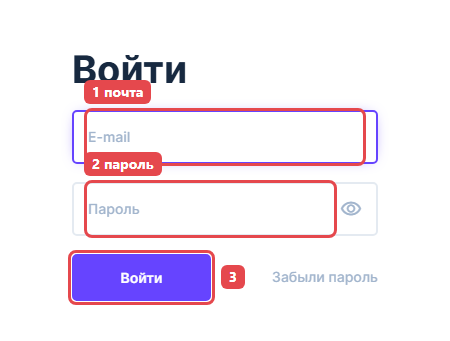

После пяти неверных паролей подряд вход блокируется на минуту — подождите и попробуйте ещё раз.

**Сменить пароль:**

1. Внизу слева нажмите на значок человечка — это ваш профиль.

   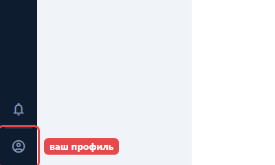

2. В поле **Пароль** впишите новый пароль. Остальные поля профиля не трогайте.

   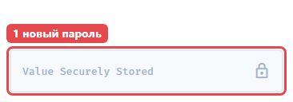

3. Нажмите круглую кнопку с галочкой вверху справа.

   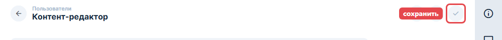

## 2. Что где лежит

Слева — список разделов.

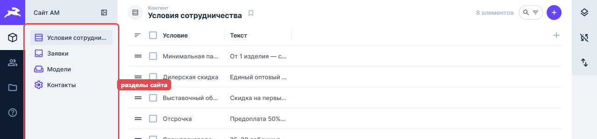

| Раздел | Что меняет на сайте |
|---|---|
| Условия сотрудничества | Таблицу «Условия сотрудничества» |
| Заявки | Ничего, только просмотр |
| Модели | Верхнюю карусель и блок «Популярные модели» |
| Контакты | Телефон в меню сайта и внизу страницы, почту и адрес внизу |

Под каждым полем серым написано, где это видно на сайте.

**Кнопки, которые нужны:**

- Круглая кнопка с галочкой вверху справа — **сохранить**. Серая — сохранять нечего. Фиолетовая — есть несохранённые правки.
- Стрелка «←» вверху слева — назад к списку.

**Кнопки, которые трогать не нужно:**

- Корзина вверху — удаляет запись насовсем.
- Значок «=» в начале строки списка — перетаскивание. Порядок сохраняется сразу, без галочки, и меняет сайт.
- Значки людей, папки и «?» в тёмной полосе слева, панели справа («Импорт / Экспорт», «ИИ помощник» и другие).

## 3. Поменять условие сотрудничества

1. В меню нажмите **Условия сотрудничества**.
2. Нажмите на нужную строку — на текст, а не на «=».

   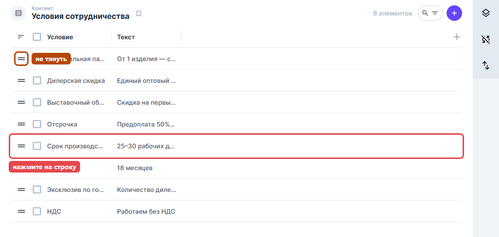

3. **Условие** — левая колонка таблицы на сайте, **Текст** — правая. Исправьте текст.

   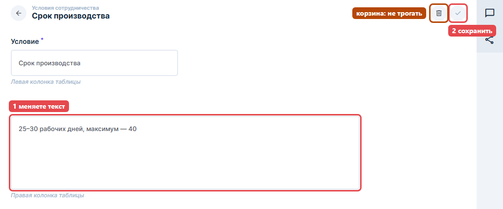

4. Галочка стала фиолетовой — нажмите её.

   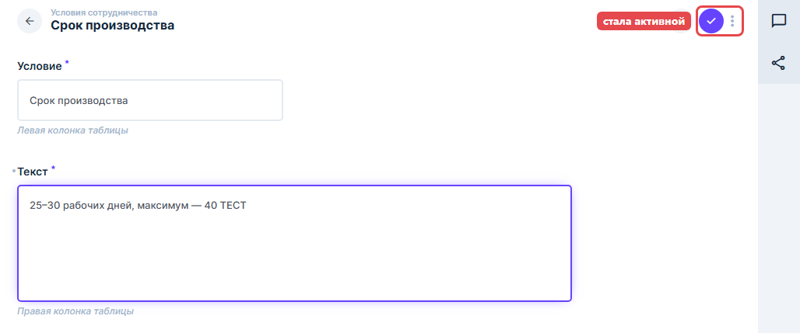

**Передумали?** Нажмите «←» и в окне выберите **Отменить изменения**. На сайте ничего не поменяется.

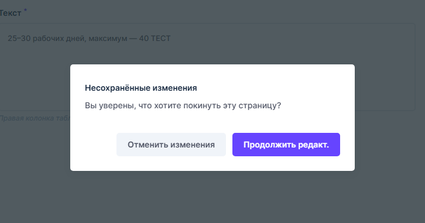

## 4. Поменять телефон, адрес или почту

1. В меню нажмите **Контакты** — сразу откроется форма.
2. Исправьте **Телефон**, **Почту** или **Адрес производства**.
   Телефон пишите так, как он должен выглядеть на сайте, например `+7 928 418-83-18`. Кнопка «позвонить» настроится сама.
3. Нажмите галочку.

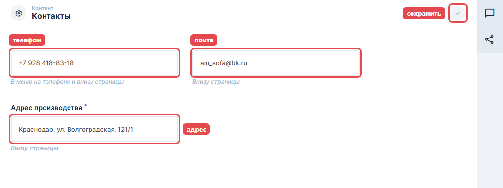

## 5. Модели

В меню нажмите **Модели**. В списке — фото, название и галочка «Показывать на сайте».

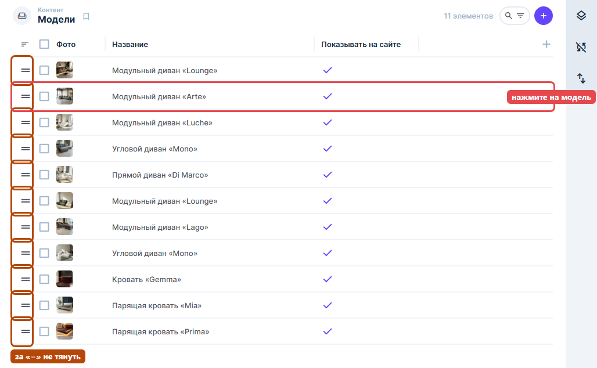

Как список связан с сайтом сейчас: первые пять строк — фото в верхней карусели, следующие шесть — блок «Популярные модели». Поэтому «Lounge» и «Mono» встречаются дважды: это разные фото одной модели, одно наверху, другое в блоке ниже. Какие пять моделей стоят в верхней карусели, настраивает Андрей, в админке это не меняется.

### Переименовать модель

1. Нажмите на модель в списке.
2. **Название** — подпись к фото на сайте. **Габариты** — если заполнить, появятся под названием в «Популярных моделях».
3. Нажмите галочку.

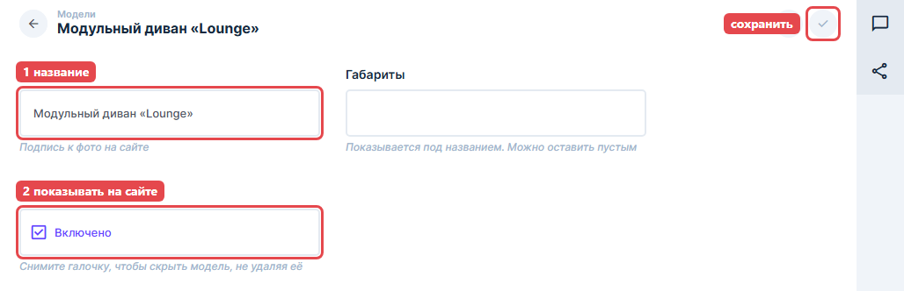

### Заменить фото

Фото меняйте с компьютера: на телефоне кнопки над фото не видны (см. раздел 9).

1. Откройте модель и прокрутите вниз до **Фото**.
2. Наведите мышку на фото — появятся кнопки. Нажмите **✕** («Снять выделение») — фото уберётся из карточки. Из библиотеки файлов оно не удаляется.

   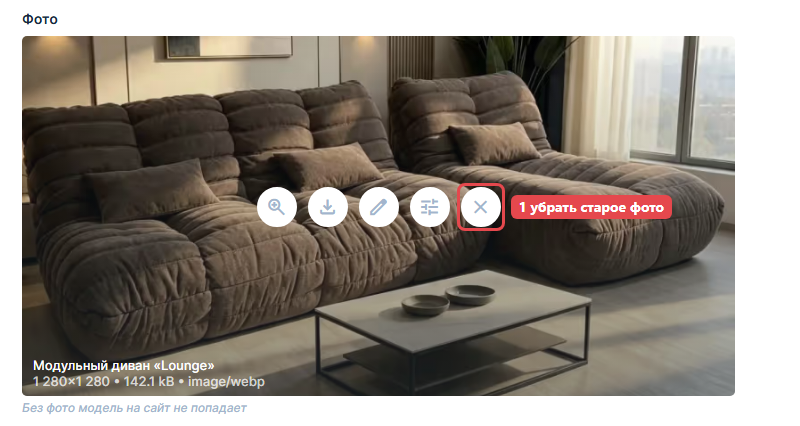

3. На месте фото появятся кнопки. Стрелка вверх — загрузить новое фото с компьютера. Папка — выбрать из уже загруженных.

   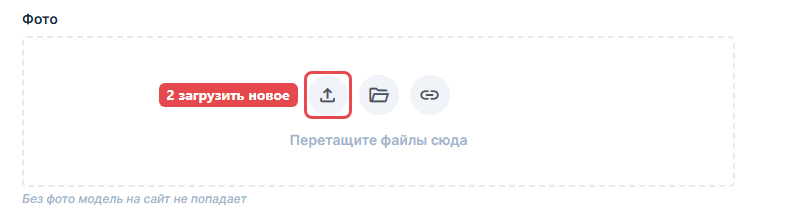

4. Нажмите галочку. Пока галочка не нажата, на сайте остаётся старое фото.

Текущие фото — квадратные, 1280×1280 точек. Новое лучше готовить в том же формате, а после сохранения проверить, как оно легло на сайте.

### Скрыть модель с сайта

1. Откройте модель.
2. В поле **Показывать на сайте** снимите галочку («Включено» пропадёт).
3. Нажмите галочку сохранения вверху.

Модель исчезнет с сайта, но останется в админке. Вернуть — той же галочкой. Если скрыть модель из первых пяти, в верхней карусели станет на одно фото меньше.

### Порядок моделей

Не меняйте его сами. Перетаскивание за «=» сохраняется сразу и может перемешать верхнюю карусель. Нужно поменять порядок — напишите Андрею.

## 6. Добавить модель

1. В разделе **Модели** нажмите фиолетовый «+» вверху справа.

   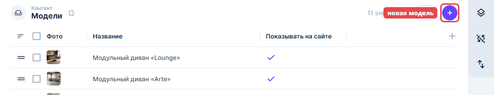

2. Заполните **Название**, загрузите **Фото** (стрелка вверх), **Показывать на сайте** оставьте включённым.
3. Нажмите галочку.

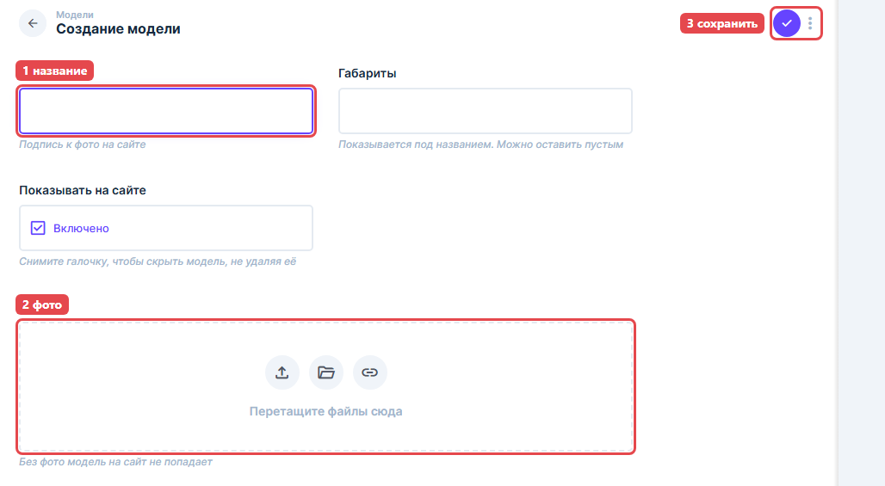

Модель без фото на сайт не попадёт. В «Популярных моделях» помещается шесть карточек, и сейчас все заняты: новая модель может вытеснить одну из текущих. Перед добавлением предупредите Андрея — он поставит её на нужное место.

## 7. Заявки

В меню нажмите **Заявки**. Сейчас там пусто: приём заявок с сайта ещё не включён.

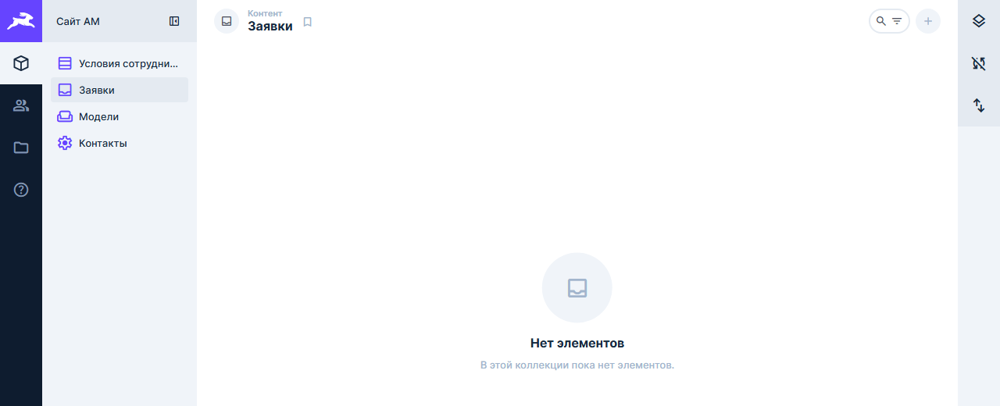

Когда включим, каждая заявка будет строкой в списке, новые — сверху. Нажмите на заявку, чтобы увидеть всё. Заявки нельзя изменить или удалить, только посмотреть.

| Поле | Что значит |
|---|---|
| Когда пришла | Дата и время заявки |
| Откуда | Форма прайса или квиз |
| Компания / ИНН, Имя, Телефон, Город | Кто оставил заявку |
| Что нужно, Уточнение | Из формы — выбранный вариант и уточнение. Из квиза — что продаёт и масштаб |
| Страница | С какой страницы сайта отправили |
| Письмо менеджеру | Ушло ли письмо о заявке |
| Рекламные метки, IP-адрес, Версия согласия, Когда дано согласие | Служебные: откуда пришёл человек и подтверждение согласия на обработку данных |

## 8. Когда изменения появятся и что делать, если что-то пошло не так

- После сохранения сайт обновляется сам примерно за минуту. Откройте сайт и обновите страницу.
- Если админка не открывается или при сохранении вышла ошибка — сайт продолжает работать с прежними данными, ничего не пропало. Позвоните Андрею.
- Сохранили не то — верните прежний текст и сохраните снова. Не помните, как было, — позвоните Андрею.
- Ничего не удаляйте и не перетаскивайте, даже чтобы «исправить».
- Сомневаетесь — звоните до того, как нажать галочку.

## 9. Можно ли с телефона

Для мелких правок — да: текст условия, телефон, адрес, почта, название модели, галочка «Показывать на сайте». Фото и новые модели делайте с компьютера.

Что мешает на телефоне:

- При каждом открытии страницы меню разделов выезжает поверх и закрывает экран. Нажмите на тёмную часть справа или выберите раздел — меню спрячется.

  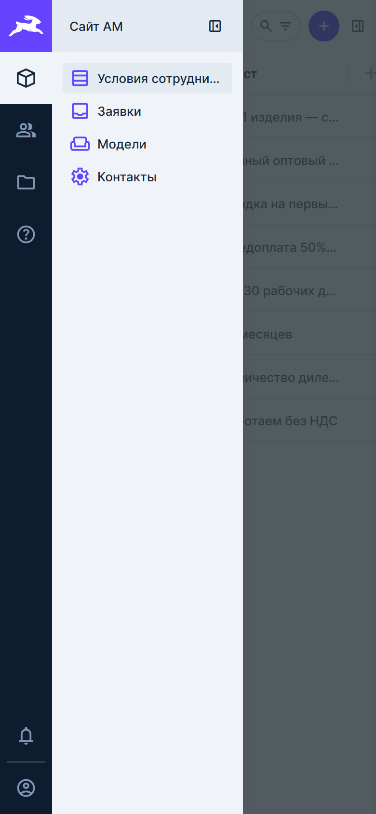

- Список условий читается: текст в строках обрезан, но нужную строку найти и нажать можно.

  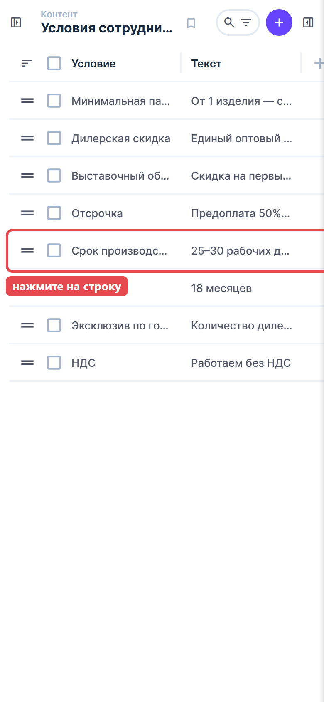

- Форма правки помещается по ширине. Галочка сохранения вверху справа стоит вплотную к корзине — нажимайте аккуратно.

  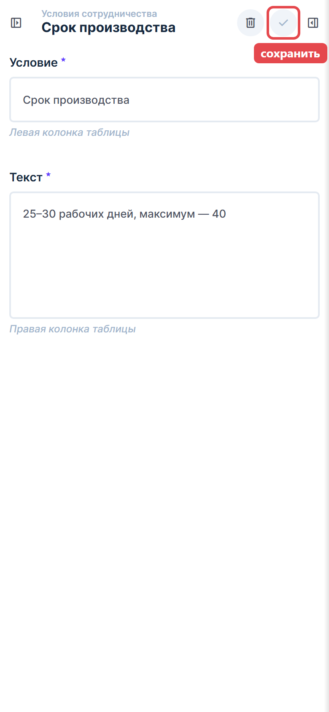

- В списке моделей видны фото и полное название. Колонка «Показывать на сайте» уходит за правый край — чтобы проверить галочку, откройте модель.

  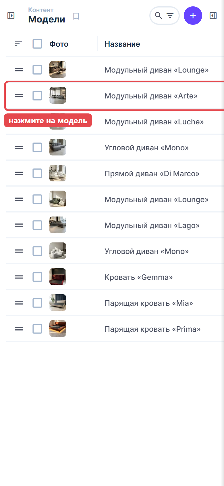

- Кнопок над фото не видно, а нажатие в центр фото попадает в невидимую кнопку. Фото с телефона не меняйте.
